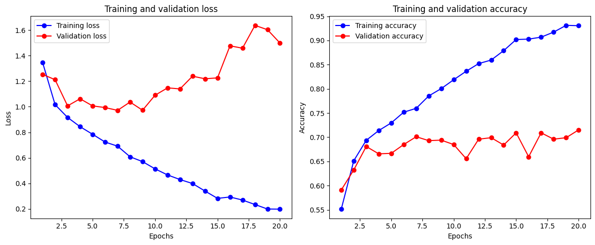
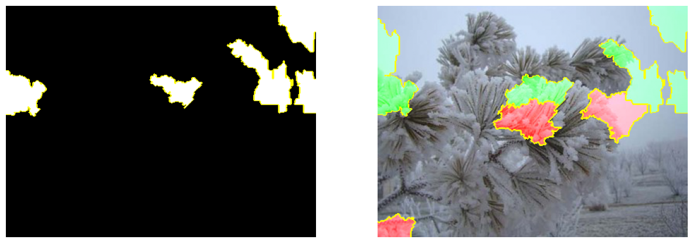

# Reconocimiento del clima en fotografías con una red convolucional

[](https://colab.research.google.com/github/CesarGuarecuco/Weather-Image-Recognition-using-Convolutional-Neural-Networks-CNN-/blob/main/clasificacion_imagenes_clima.ipynb) [](https://nbviewer.org/github/CesarGuarecuco/Weather-Image-Recognition-using-Convolutional-Neural-Networks-CNN-/blob/main/clasificacion_imagenes_clima.ipynb)

Proyecto académico (2024). Una red neuronal convolucional en PyTorch que clasifica fotografías en 11 tipos de clima (rocío, niebla, escarcha, hielo, granizo, rayos, lluvia, arcoíris, escarcha blanca, tormenta de arena y nieve), y explica cada predicción con LIME.

## Resultado

- Exactitud en validación: **71,5%** después de 20 épocas, con 11 clases (al azar sería cerca de 9%).
- La exactitud de entrenamiento llega a 93%: el modelo se sobreajusta desde la época 5. El siguiente paso sería más aumento de datos, *early stopping* o partir de una red preentrenada (*transfer learning*).



LIME marca qué zonas de la imagen usó el modelo para decidir. En este ejemplo, la clase "glaze" (hielo) se apoya en las ramas congeladas:



## Qué incluye el notebook

1. Análisis exploratorio: imágenes por categoría, tamaños, proporciones y colores.
2. Aumento de datos: redimensionado a 64×64, rotación y recorte aleatorio, normalización.
3. Red con tres capas convolucionales y dos capas densas (ReLU, softmax).
4. Entrenamiento, evaluación, guardado del modelo y prueba con una imagen al azar.
5. Explicación de predicciones con LIME.

## Datos

Dataset público [Weather Image Recognition](https://www.kaggle.com/datasets/jehanbhathena/weather-dataset) de Kaggle (11 categorías). No se incluye en el repositorio. Las rutas del notebook apuntan a una carpeta local: cámbialas por la carpeta donde descargues las imágenes.

## Cómo ejecutarlo

```bash
pip install -r requirements.txt
jupyter notebook clasificacion_imagenes_clima.ipynb
```

Se recomienda GPU (en Colab: Entorno de ejecución → Cambiar tipo de entorno → GPU).

---

¿Necesitas un análisis o un modelo como este con los datos de tu organización? [Sivax Intelligence](https://sivax-intelligent.netlify.app/) · [sivax.contacto@gmail.com](mailto:sivax.contacto@gmail.com)
